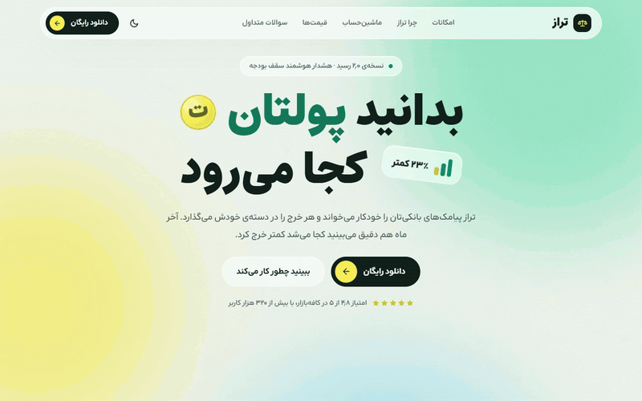
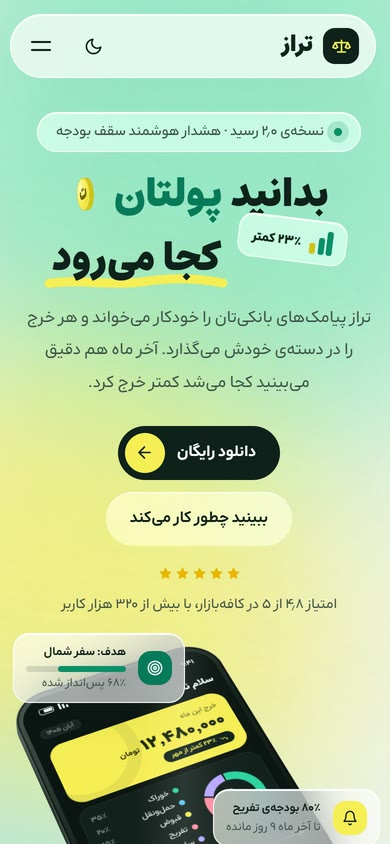
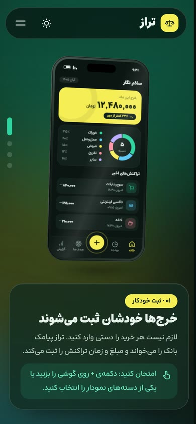

<div dir="rtl">

# تراز

لندینگ پیج یک اپلیکیشن خیالی مدیریت مالی شخصی. این صفحه را برای نمونه‌کار طراحی وب ساختم و برند، متن‌ها، طراحی و کدش همه از خودم است.

**نسخه‌ی آنلاین:** [mohammadreza-hosseini-rashed.github.io/taraz](https://mohammadreza-hosseini-rashed.github.io/taraz/)

</div>

<p align="center">
  
</p>

<div dir="rtl">

## چه چیزهایی در این صفحه هست

- گوشی سه‌بعدی که فقط با CSS ساخته شده. با اسکرول از حالت خوابیده بلند می‌شود، یک دور می‌چرخد و کنار چهار مرحله‌ی معرفی اپ می‌نشیند.
- اپ داخل گوشی واقعاً کار می‌کند: دکمه‌ی + یک خرج نمونه ثبت می‌کند، دسته‌های نمودار قابل انتخاب‌اند و تب‌های پایین صفحه را عوض می‌کنند.
- تم روشن و تیره که انتخاب کاربر را نگه می‌دارد.
- طراحی شیشه‌ای که شکل‌های رنگی از پشت کارت‌ها دیده می‌شوند، بدون اینکه خوانایی متن کم شود. کنتراست همه‌ی متن‌ها در هر دو تم مطابق WCAG AA است.
- ماشین‌حساب پس‌انداز با دو اسلایدر، و جدول قیمت با سوییچ ماهانه و سالانه.
- راست‌چین کامل، اعداد فارسی و نسخه‌ی موبایل جداگانه برای بخش معرفی اپ.

## نمای موبایل

</div>

<p align="center">
  
  &nbsp;&nbsp;
  
</p>

<div dir="rtl">

## ساختار

صفحه با HTML و CSS و جاوااسکریپت خالص نوشته شده؛ بدون فریم‌ورک، بدون کتابخانه و بدون مرحله‌ی build.

| فایل | کاربرد |
|---|---|
| `index.html` | ساختار صفحه و آیکن‌ها |
| `style.css` | طراحی، دو تم و نسخه‌ی موبایل |
| `script.js` | موتور اسکرول گوشی، اپ داخل گوشی، ماشین‌حساب و سوییچ قیمت |
| `fonts/` | فونت‌های استعداد (تیتر) و آراد (متن) |
| `img/` | نشان مارکت‌ها و لوگوی بانک‌ها |

## اجرا روی سیستم

یک سرور ساده در پوشه‌ی پروژه بالا بیاورید و آدرس `http://localhost:5500` را باز کنید:

</div>

```bash
python -m http.server 5500
```

<div dir="rtl">

## منابع

- برند «تراز» و همه‌ی آمار، نظرها و قیمت‌های صفحه ساختگی‌اند.
- فونت [استعداد](https://github.com/aminabedi68/Estedad) از امین عابدی و فونت [آراد](https://github.com/MohamadDarvishi/Arad) از محمد درویشی، هر دو با مجوز SIL OFL.
- لوگوی بانک‌ها از مجموعه‌ی [Persian Labs Icons](https://github.com/persianlabs/icons) با مجوز MIT.
- نشان‌های بازار، مایکت و سیب‌اپ متعلق به صاحبانشان است و از صفحه‌ی رسمی هر کدام برداشته شده.

طراحی و توسعه: محمدرضا حسینی راشد

</div>

---

## English

Taraz is a landing page for a fictional personal-finance app, made as a web design portfolio piece. It is in Persian (right-to-left) and written in plain HTML, CSS and JavaScript, with no framework and no build step.

The centerpiece is a phone built entirely in CSS 3D. As you scroll it lifts out of the hero, turns around once and docks next to a four-step tour of the app, and the app inside it is clickable. The page also has light and dark themes, a glassmorphism look that keeps WCAG AA text contrast in both themes, a savings calculator and a monthly/yearly pricing switch.

Live demo: [mohammadreza-hosseini-rashed.github.io/taraz](https://mohammadreza-hosseini-rashed.github.io/taraz/)
